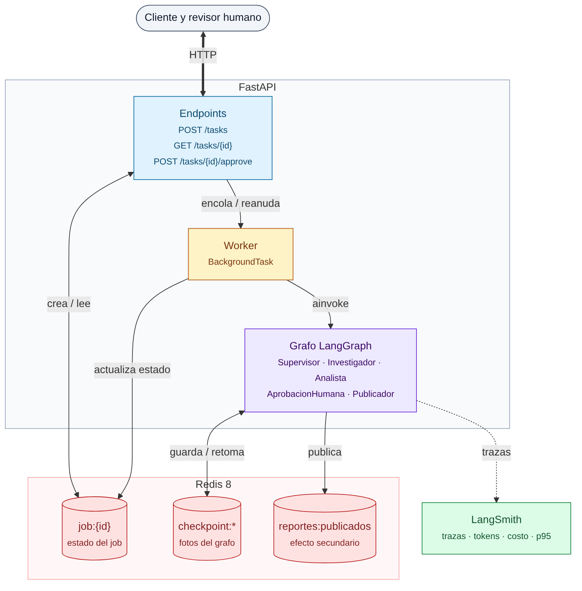
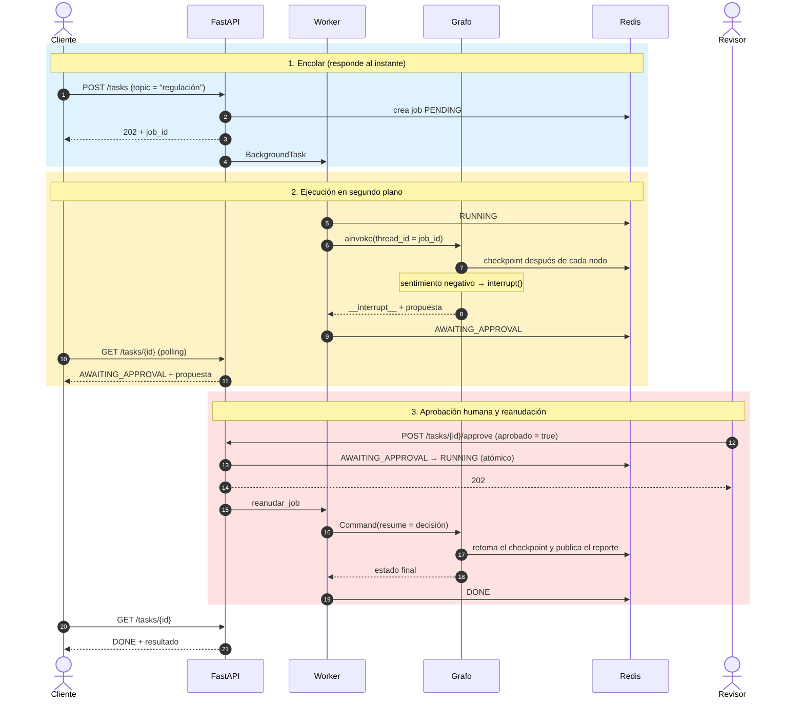
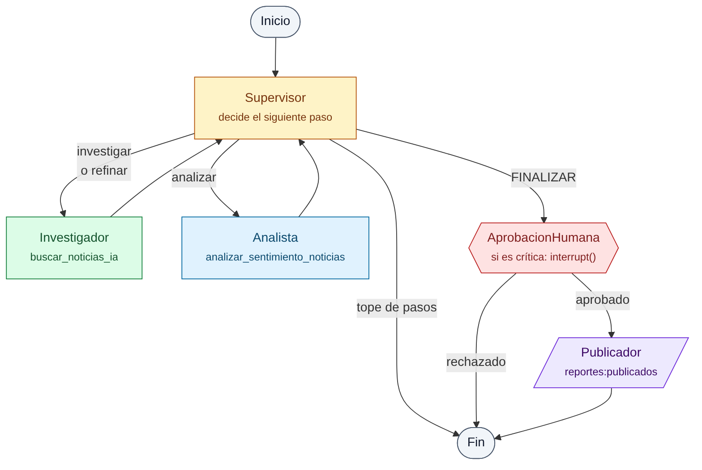
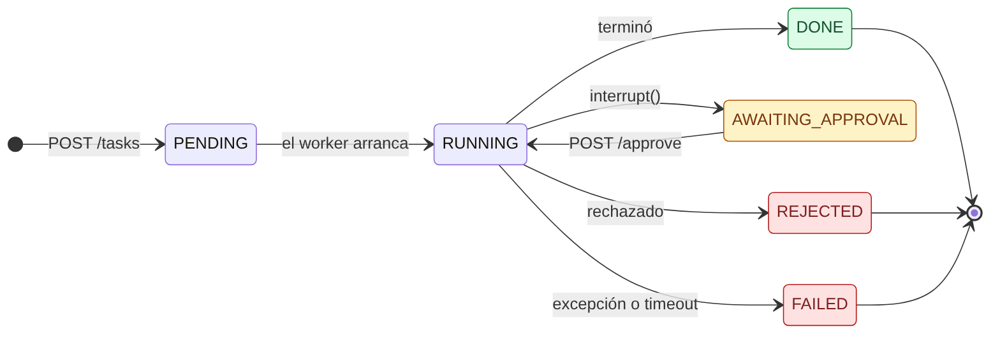
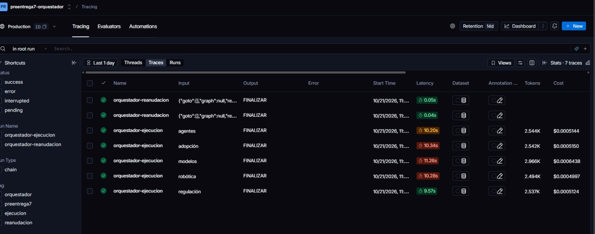
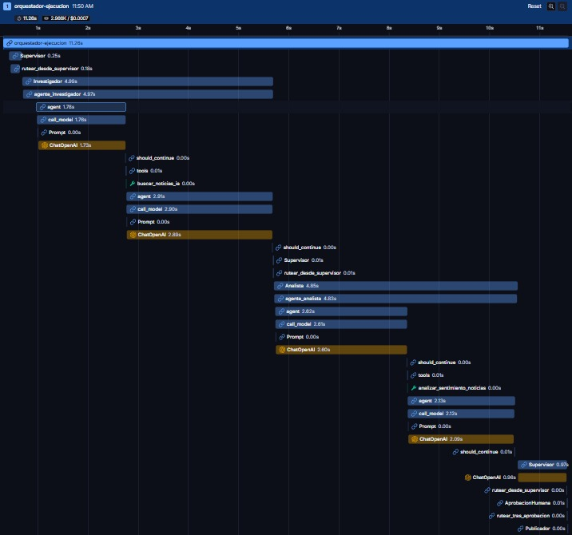

# Pre-entrega 7: API de producción y monitoreo activo

API REST con **FastAPI** que expone el orquestador multi-agente de la
Pre-entrega 6. Ese orquestador tiene un Supervisor, un Investigador y un
Analista, y trabaja sobre noticias de IA. Esta versión le suma:

- **Endpoints asíncronos.** `POST /tasks` encola la tarea y devuelve un `job_id` al instante, sin bloquear el event loop.
- **Redis.** Guarda el estado de cada job (`PENDING → RUNNING → DONE / FAILED …`) y los **checkpoints de LangGraph** (`AsyncRedisSaver`).
- **Observabilidad con LangSmith.** Cada ejecución envía una traza con latencia, tokens y costo de cada nodo.
- **Human-in-the-loop.** Antes de **publicar** un reporte (una acción con efectos secundarios), el grafo se pausa con `interrupt()` si la tarea es crítica. Recién continúa cuando llega `POST /tasks/{id}/approve`.
- **Prueba de carga.** El script `scripts/carga_concurrente.py` lanza 5 peticiones concurrentes.

---

## 1. Arquitectura

### Vista general

La API, el worker y el grafo corren en el mismo proceso de FastAPI. Redis
guarda tres cosas distintas, y LangSmith recibe las trazas de cada ejecución.



### Recorrido de una tarea crítica, paso a paso

Ejemplo con `"regulación"`, que da sentimiento negativo y por eso necesita
aprobación humana. Una tarea no crítica hace lo mismo, pero sin el bloque 3:
el grafo publica directo y el job pasa a `DONE`.



### El grafo



Respecto de la Pre-entrega 6, cambia una sola cosa del flujo. Cuando el
Supervisor decide `FINALIZAR` y ya hay un análisis suficiente, el grafo no
termina: pasa por **AprobacionHumana** y después por **Publicador**. Si se
cortó por el contador de pasos y no hay análisis útil, termina sin publicar.

> Los diagramas están hechos con Mermaid. El código fuente de cada uno está en
> `docs/diagramas/*.mmd`, y las imágenes se generan con
> `npx @mermaid-js/mermaid-cli -i docs/diagramas/<nombre>.mmd -o docs/diagramas/<nombre>.png -b white -s 2`.

### Estructura del repositorio

```
preentrega7/
├── app/
│   ├── main.py            # FastAPI: lifespan (Redis + checkpointer), POST/GET /tasks, /reportes, /health
│   ├── graph.py           # orquestador M6 + nodos AprobacionHumana/Publicador + checkpointer_redis()
│   ├── worker.py          # corre/reanuda el grafo en segundo plano; cualquier excepción → FAILED
│   ├── jobs.py            # JobStore: estado de los jobs en Redis (async, TTL, transición atómica)
│   ├── observability.py   # LangSmith: validación al arrancar, metadata/tags por job, flush al apagar
│   ├── hitl.py            # regla de criticidad + nodo con interrupt() + POST /tasks/{id}/approve
│   ├── dependencies.py    # dependencias de FastAPI (JobStore y grafo desde app.state)
│   ├── state.py           # AgentState + artefactos Pydantic + lista blanca de tipos del checkpointer
│   └── agents/            # Investigador y Analista (Pre-entrega 6, con @traceable)
├── scripts/carga_concurrente.py   # 5 peticiones concurrentes + resumen de latencias
├── tests/                 # 69 tests, sin API key ni Redis (LLM falso + fakeredis + InMemorySaver)
├── screenshots/           # capturas reales de LangSmith (trazas, costo, latencia, HITL, tokens)
├── docs/diagramas/        # diagramas del README (fuente .mmd + imagen .png)
├── Dockerfile · docker-compose.yml · requirements.txt · .env.example · pytest.ini
└── README.md
```

---

## 2. Cómo levantarlo

### Requisitos

- Docker Desktop (para Redis 8 y, si querés, también la API).
- Una API key de OpenAI (o Anthropic).
- Una API key de LangSmith. Los pasos para crearla están más abajo.

```bash
cp .env.example .env      # completar OPENAI_API_KEY y LANGSMITH_API_KEY
```

#### Cómo crear la API key de LangSmith

1. Entrá a <https://smith.langchain.com> y creá una cuenta. Podés usar Google, GitHub o un mail, y el plan gratuito alcanza para este proyecto.
2. Abrí **Settings** (el engranaje, abajo a la izquierda) → **API Keys** → **Create API Key**. Elegí el tipo *Personal Access Token*.
3. Copiá la key, que empieza con `lsv2_pt_`. **Se muestra una sola vez.**
4. En el `.env`, reemplazá el valor de ejemplo `lsv2_...` por tu key, y dejá `LANGSMITH_TRACING=true`.
5. Si tu cuenta quedó en la región de Europa (la URL dice `eu.smith.langchain.com`), descomentá `LANGSMITH_ENDPOINT` en el `.env`.

No hace falta crear el proyecto a mano: LangSmith lo crea solo con la primera traza.

> **Si cambiás el `.env` con los contenedores ya levantados**, Docker no
> relee el archivo. Hay que recrear el contenedor con
> `docker compose up -d --force-recreate api`.

### Opción A: todo con Docker Compose (recomendada)

```bash
docker compose up --build
```

Esto levanta Redis 8 y la API en <http://localhost:8000>. La documentación
interactiva (Swagger) queda en <http://localhost:8000/docs>.

### Opción B: Redis en Docker y la API en tu máquina

```bash
docker compose up -d redis             # solo Redis 8
python -m venv venv
venv\Scripts\activate                  # Windows   (macOS/Linux: source venv/bin/activate)
pip install -r requirements.txt
uvicorn app.main:app --reload --port 8000
```

> **Importante: hace falta Redis 8, no Redis 7.** El checkpointer de
> LangGraph (`AsyncRedisSaver`) usa los módulos de búsqueda y JSON de Redis,
> que vienen incluidos desde Redis 8. Por eso el `docker-compose.yml` usa la
> imagen `redis:8`. Con un Redis 7 sin esos módulos, la API falla al
> arrancar con `unknown command 'FT.INFO'`.

Para comprobar que todo está bien:

```bash
curl http://localhost:8000/health
# {"status":"ok","redis":true,"observabilidad":{"plataforma":"langsmith","activo":true,"proyecto":"preentrega7-orquestador","conexion":"ok"}}
```

En `observabilidad`, lo que importa es `"conexion": "ok"`: significa que LangSmith aceptó la key. Si dice otra cosa, el campo `motivo` explica qué pasa. Por ejemplo, avisa si quedó el valor de ejemplo de `.env.example` o si LangSmith rechazó la key.

---

## 3. Uso de la API

| Método | Ruta | Qué hace |
|---|---|---|
| `POST` | `/tasks` | Crea y encola una tarea. Devuelve **202** con el `job_id` |
| `GET` | `/tasks/{job_id}` | Devuelve el estado del job (para hacer polling) |
| `GET` | `/tasks` | Lista los últimos jobs |
| `POST` | `/tasks/{job_id}/approve` | Envía la decisión humana (`{"aprobado": true/false, "comentario", "revisor"}`) |
| `GET` | `/reportes` | Lista los reportes publicados (el efecto secundario) |
| `GET` | `/health` | Muestra el estado de Redis y de LangSmith |

### Ejemplo: tarea crítica con aprobación humana

```bash
# 1) Encolar: responde enseguida con el job_id
curl -X POST localhost:8000/tasks -H "Content-Type: application/json" -d '{"topic": "regulación"}'
# {"job_id":"ec97562c-...","status":"PENDING","links":{...}}

# 2) Consultar: el sentimiento es negativo, así que queda esperando aprobación
curl localhost:8000/tasks/ec97562c-...
# {"status":"AWAITING_APPROVAL","aprobacion_pendiente":{"motivo":"El reporte tiene sentimiento general NEGATIVO ...","propuesta":{...}}, ...}

# 3) Aprobar (o rechazar con "aprobado": false)
curl -X POST localhost:8000/tasks/ec97562c-.../approve -H "Content-Type: application/json" \
     -d '{"aprobado": true, "comentario": "OK", "revisor": "rayo"}'

# 4) Consultar de nuevo: DONE, y el reporte aparece en /reportes
curl localhost:8000/tasks/ec97562c-...
```

> En PowerShell, `curl` es un alias de otro comando. Usá `curl.exe`, o
> directamente Swagger en `/docs`, que es lo más cómodo.

### Estados de un job



| Estado | Significado |
|---|---|
| `PENDING` | Se encoló y todavía no arrancó |
| `RUNNING` | El grafo está corriendo, o reanudándose después de una aprobación |
| `AWAITING_APPROVAL` | Está pausado en `AprobacionHumana`. El campo `aprobacion_pendiente` explica por qué y qué se va a publicar |
| `DONE` | Terminó. Publicó, o no había nada que publicar |
| `REJECTED` | La persona que revisaba rechazó la publicación |
| `FAILED` | Hubo una excepción o un timeout en el worker. El campo `error` dice qué pasó |

---

## 4. Decisiones de diseño

### Asincronía: cómo se evita bloquear el event loop

- `POST /tasks` hace **una sola escritura** en Redis y responde **202**. El grafo se ejecuta después, como `BackgroundTask`.
- Todo lo que espera algo externo es `async`:
  - Redis, con `redis.asyncio`;
  - el checkpointer, con `AsyncRedisSaver`;
  - el grafo, con `ainvoke`, que a su vez llama al LLM de forma asíncrona.

  No hay ninguna llamada de red síncrona dentro de un endpoint ni del worker. Las herramientas de los agentes son funciones síncronas, pero muy cortas, y LangChain las corre en un thread aparte. Mientras una tarea espera al LLM, el event loop atiende otros pedidos.
- Hay **un solo grafo compilado** para toda la API. Los jobs concurrentes no se mezclan porque cada uno usa su propio `thread_id = job_id`. El test `test_cinco_jobs_concurrentes_con_el_mismo_grafo_no_se_mezclan` lo verifica.
- **Worker:** se usa el patrón de BackgroundTask simple, que la consigna acepta para esta etapa. Para escalar a varios servidores, el siguiente paso sería un worker separado (Arq o Celery) que lea de una cola en Redis. No se implementó para no sumar otra pieza que levantar.

### Manejo de errores en background ("error común" de la consigna)

`worker.ejecutar_job` y `worker.reanudar_job` envuelven todo en
`try/except Exception` y además tienen un **timeout**
(`TIMEOUT_JOB_SEGUNDOS`, 300 s por defecto). Cualquier falla deja el job en
**`FAILED`** con el mensaje de error, y el cliente deja de hacer polling.
Esto lo cubren tests de excepción en el grafo, de timeout y de error al
reanudar.

### Persistencia con Redis

En Redis se guardan dos cosas distintas:

| Clave | Para qué | Quién la escribe |
|---|---|---|
| `job:{id}` | Estado del job que ve el cliente (JSON, vence a los 7 días) | `JobStore` (`app/jobs.py`) |
| `checkpoint:*`, `checkpoint_write:*` | "Fotos" del estado del grafo, nodo por nodo (vencen a las 24 h) | `AsyncRedisSaver` (`app/graph.py`) |
| `reportes:publicados` | El "canal" donde se publican los reportes (efecto secundario) | nodo `Publicador` |

Gracias a los checkpoints en Redis, un job pausado sobrevive a un reinicio de
la API. El test `test_reanudar_con_un_grafo_nuevo_mismo_checkpointer`
simula ese caso.

Se pueden inspeccionar las claves así:

```bash
docker compose exec redis redis-cli --scan --pattern 'job:*'
docker compose exec redis redis-cli GET job:<id>
docker compose exec redis redis-cli LRANGE reportes:publicados 0 -1
```

Otros detalles de la persistencia:

- **Aprobaciones simultáneas.** La transición `AWAITING_APPROVAL → RUNNING` es atómica: usa `WATCH/MULTI/EXEC`, que es concurrencia optimista. Si llegan dos aprobaciones a la vez, solo una reanuda el grafo y la otra recibe **409**. Lo probé contra un Redis real lanzando 10 aprobaciones simultáneas, y ganó exactamente 1.
- **Lista blanca del checkpointer.** El checkpointer solo puede reconstruir las clases propias listadas en `TIPOS_SERIALIZABLES` (`app/state.py`). Reconstruir objetos a partir de bytes guardados afuera es un punto sensible de seguridad, y LangGraph va a bloquear por defecto las clases no registradas.
- **La lista blanca tiene que cubrir los dos formatos.** El checkpointer de Redis guarda el estado como JSON, así que además de `allowed_msgpack_modules` hace falta `allowed_json_modules` (ver `serializador_redis()` en `app/graph.py`). En la primera corrida real faltaba la segunda: los jobs que pasaban por aprobación fallaban al reanudarse con `AttributeError: 'dict' object has no attribute 'sentimiento_general'`, porque el análisis volvía de Redis como diccionario. Los tests no lo detectaban porque el checkpointer en memoria usa solo msgpack. Ahora lo cubre `tests/test_checkpointer_redis.py`, que usa el código real de conversión a JSON de `AsyncRedisSaver` y falla si se quita el arreglo.

### Human-in-the-loop

- **La acción crítica** es el nodo `Publicador`: escribe el reporte en `reportes:publicados`, un efecto secundario que no se puede deshacer.
- **Cuándo es crítica** (`evaluar_criticidad` en `app/hitl.py`): cuando el sentimiento general es **negativo**, por el riesgo reputacional de publicar malas noticias, o cuando el cliente envía `"forzar_aprobacion": true`. En cualquier otro caso se publica sin pausa, y queda registrado `aprobacion.requerida = false`.
- **Cómo se pausa.** `interrupt(payload)` guarda un checkpoint y corta la ejecución. El worker ve `__interrupt__` en el resultado y marca el job como `AWAITING_APPROVAL`.
- **Cómo se reanuda.** `Command(resume=decision)` en el mismo `thread_id`. LangGraph vuelve a ejecutar el nodo desde el principio, y esta vez `interrupt()` devuelve la decisión. Por eso todo lo que está antes del `interrupt()` es puro, sin efectos secundarios: se ejecuta dos veces.
- **Validación.** La decisión se valida con Pydantic (`DecisionHumana`) dos veces: en el endpoint y otra vez dentro del nodo.

### Observabilidad (LangSmith)

- **Activación.** Con `LANGSMITH_TRACING=true`, LangGraph envía cada `ainvoke` como una traza, sin tocar los nodos.
- **`@traceable`** en `investigar()` y `analizar()`, las funciones que llaman al LLM. Así aparecen como *spans* con nombre propio: `agente_investigador` y `agente_analista`.
- **Etiquetas por ejecución** (`config_de_ejecucion`):
  - `run_name`: `orquestador-ejecucion` u `orquestador-reanudacion`;
  - `tags`: `preentrega7` y la etapa;
  - `metadata`: `job_id`, `thread_id`, modelo.

  Con `metadata.thread_id`, LangSmith agrupa la ejecución inicial y la reanudación del HITL en el mismo *Thread*.
- **Validación al arrancar** (`inicializar_observabilidad` + `verificar_conexion`). Revisa que la key exista, que no sea el texto de ejemplo de `.env.example`, y hace una consulta real a LangSmith para confirmar que la acepta. Si algo falla, apaga el tracing y `/health` dice por qué. Se agregó después de la primera corrida real: con el valor de ejemplo `lsv2_...`, `/health` decía `"activo": true` mientras LangSmith rechazaba las trazas en silencio.
- **Al apagar.** `wait_for_all_tracers()` envía las trazas que hayan quedado pendientes.

### Búsqueda más robusta (mejora sobre la Pre-entrega 6)

`buscar_noticias_ia` ahora busca por palabras clave. Antes exigía que la frase
completa apareciera textual en la noticia. Con un LLM real, que a veces pasa
`"regulación de la IA"` en lugar de `"regulación"`, la versión anterior
devolvía 0 resultados.

---

## 5. Prueba de carga y capturas

Con la API levantada y LangSmith activo:

```bash
python scripts/carga_concurrente.py              # aprueba automáticamente los HITL
python scripts/carga_concurrente.py --no-aprobar # deja los HITL pausados (para capturarlos)
```

El script lanza 5 `POST /tasks` **a la vez**, con los temas `modelos`,
`regulación`, `robótica`, `adopción` y `agentes`:

- 3 tienen sentimiento positivo y se publican solos.
- 2 tienen sentimiento negativo y pasan por aprobación humana.

Después hace polling hasta que terminan, imprime una tabla con latencias
(incluido el p95 visto desde el cliente) y guarda los resultados en
`resultados/carga_*.json`.

Cómo leer el dashboard de LangSmith:

1. Entrá al proyecto `preentrega7-orquestador` y filtrá por `tag = preentrega7`.
2. **Latencia p95:** pestaña **Monitor**, gráfico de latencia en percentil p95.
3. **Costo por ejecución:** columna *Cost* de cada traza. LangSmith la calcula a partir de los tokens de entrada y salida.
4. **Nodo con más tokens:** abrí una traza y compará los *spans* `agente_investigador`, `agente_analista` y la decisión del Supervisor.

El detalle de cada captura está en [`screenshots/README.md`](screenshots/README.md).

### Resultado real de la prueba de carga

Corrida contra la API levantada con Docker Compose (Redis 8), con
`gpt-4o-mini` y LangSmith verificado (`"conexion": "ok"`). Las capturas de
`screenshots/` corresponden a esta corrida.

```
API: {'status': 'ok', 'redis': True, 'observabilidad': {'plataforma': 'langsmith', 'activo': True, 'proyecto': 'preentrega7-orquestador', 'conexion': 'ok'}}

Lanzando 5 peticiones CONCURRENTES...
  → [modelos] job_id=05811ab4-a529-403e-b472-801030b39e43  (POST respondió en 157.2 ms)
  → [regulación] job_id=8b9f063d-0d86-4e38-bc1a-dc6bb8e29b65  (POST respondió en 49.7 ms)
  → [robótica] job_id=54092864-4969-4b5d-bd67-9416e912b8de  (POST respondió en 157.0 ms)
  → [adopción] job_id=fe91e9f6-fd48-4c2b-9220-d999f226947c  (POST respondió en 160.8 ms)
  → [agentes] job_id=e6a980c6-96ac-4a02-9ae2-b0a12f7567b4  (POST respondió en 268.9 ms)

Haciendo polling hasta que terminen...
  ⏸  [regulación] pide aprobación humana: El reporte tiene sentimiento general NEGATIVO (score promedio 0.05). Publicarlo tiene riesgo reputacional: requiere aprobación humana.
  ✅ [regulación] aprobado (HTTP 202)
  ⏸  [agentes] pide aprobación humana: El reporte tiene sentimiento general NEGATIVO (score promedio 0.05). Publicarlo tiene riesgo reputacional: requiere aprobación humana.
  ✅ [agentes] aprobado (HTTP 202)

================================================================================================
tema         estado             HITL  sentim.   publicó   POST ms  total s  servidor s
------------------------------------------------------------------------------------------------
modelos      DONE               no    positivo  sí          157.2    11.95      11.305
regulación   DONE               sí    negativo  sí           49.7    10.46       9.915
robótica     DONE               no    positivo  sí          157.0    10.91       10.33
adopción     DONE               no    positivo  sí          160.8    10.91      10.361
agentes      DONE               sí    negativo  sí          268.9    11.47      10.731
================================================================================================
Tiempo total de la corrida: 11.95 s
Latencia de POST /tasks  -> máx 268.9 ms | p95 268.9 ms
Latencia extremo a extremo (cliente) -> p50 10.91 s | p95 11.95 s
```

Qué muestra esta corrida:

- **La API no se bloqueó.** Los 5 `POST /tasks` respondieron en 50 a 269 ms, cuando cada tarea tarda entre 10 y 12 segundos.
- **Las tareas corrieron en paralelo.** La corrida completa duró 11.95 s, prácticamente lo que tarda la tarea más lenta. En serie habría tardado unos 53 s, la suma de las cinco.
- **Los dos caminos del HITL funcionan.** Los temas con sentimiento negativo (`regulación` y `agentes`) se pausaron en `AWAITING_APPROVAL`, se aprobaron por la API y se reanudaron desde el checkpoint guardado en Redis. Los otros tres se publicaron sin pausa.

### Lectura del dashboard de LangSmith

Las capturas están en [`screenshots/`](screenshots/README.md). En la corrida
se ven **7 trazas**: 5 `orquestador-ejecucion`, una por petición, y 2
`orquestador-reanudacion`, de los jobs que pasaron por aprobación humana.



**Costo por ejecución.** LangSmith lo calcula a partir de los tokens de entrada y salida de `gpt-4o-mini`:

| Ejecución | Latencia | Tokens | Costo |
|---|---|---|---|
| `modelos` | 11.26 s | 2.966K | $0.0006438 |
| `adopción` | 10.34 s | 2.542K | $0.0005150 |
| `robótica` | 10.28 s | 2.494K | $0.0004997 |
| `agentes` (HITL) | 10.20 s + 0.05 s de reanudación | 2.544K | $0.0005144 |
| `regulación` (HITL) | 9.57 s + 0.04 s de reanudación | 2.537K | $0.0005124 |
| **Promedio** | **10.33 s** | **2.617K** | **$0.000537** |

- El costo por ejecución va de **$0.00050 a $0.00064**. Cada una usa unos 2.6K tokens, y la corrida completa costó **$0.0027**.
- Las reanudaciones después de la aprobación cuestan $0, porque no llaman al LLM: solo recuperan el checkpoint de Redis, publican y terminan. Tardan entre 0.04 y 0.05 s.
- `modelos` es la ejecución más cara porque su búsqueda trae 2 noticias en lugar de 1, y eso le da más contexto al Investigador y al Analista.

**Latencia p95 y P50.** Se toman las latencias de las 5 trazas de ejecución que muestra el dashboard: 9.57, 10.20, 10.28, 10.34 y 11.26 s.

| Métrica | Valor |
|---|---|
| P50 (mediana) | **10.28 s** |
| **p95** | **11.26 s** (método *nearest-rank*; con interpolación lineal da 11.08 s) |
| p95 visto desde el cliente (`carga_concurrente.py`) | 11.95 s |

Con solo 5 muestras, el p95 por *nearest-rank* coincide con la ejecución más
lenta (`modelos`). El p95 del cliente es unos 0.7 s mayor porque suma el
intervalo de polling (0.5 s) y el viaje HTTP. LangSmith muestra P50 y P99 por
defecto (vista *Threads*, captura 04), por eso el p95 se calcula a partir de
las latencias del dashboard.

**Dónde se concentra la latencia.** Vista *Waterfall* de la traza de `modelos`, 11.26 s:



| Paso | Tiempo | % del total |
|---|---|---|
| Investigador (2 llamadas al LLM + herramienta) | 4.99 s | 44 % |
| Analista (2 llamadas al LLM + herramienta) | 4.85 s | 43 % |
| Supervisor, decisión final (1 llamada al LLM) | 0.97 s | 9 % |
| Supervisor, primer paso (sin LLM, regla en código) | 0.25 s | 2 % |
| Herramientas, AprobacionHumana, Publicador | ≈ 0.01 s cada uno | ≈ 0 % |

- **El 91 % del tiempo (10.27 de 11.26 s) es esperar a OpenAI**, repartido en las 5 llamadas a `ChatOpenAI`.
- Las herramientas simuladas, el ruteo, el HITL y la publicación son prácticamente instantáneos.
- Esto confirma que lo correcto era hacer la API asíncrona: el servidor pasa casi todo el tiempo esperando a la red, y en esa espera atiende otras peticiones.

**Qué nodo consume más tokens.** Capturas 06a, 06b y 06c:

| Llamada al LLM | Entrada | Salida | Total |
|---|---|---|---|
| Investigador, 1ª (decide llamar a `buscar_noticias_ia`) | 384 | 19 | 403 |
| **Investigador, 2ª (redacta con el resultado de la herramienta)** | **577** | **163** | **740** |
| Analista (llamada medida) | 480 | 152 | 632 |

- **El Investigador es el nodo que más tokens consume**: 1,143 tokens entre sus dos llamadas, cerca del 44 % de una ejecución.
- Su segunda llamada es la más cara de las medidas. El resultado de la herramienta, con el JSON completo de las noticias, entra en el contexto como entrada.

**Mejora detectada a partir del dashboard.** La segunda llamada de cada especialista solo redacta un texto de cierre ("Encontré noticias...", "Listo, analicé..."). El código lo descarta, porque toma el resultado directamente del `ToolMessage` de la herramienta (ver `investigar()` y `analizar()`). En la traza medida, esas dos llamadas suman **4.98 s (44 % de la latencia)**. Solo la segunda del Investigador ya son 740 de unos 2.5K tokens (29 %), y a eso se suma la segunda del Analista.

El paso siguiente sería marcar las herramientas con `return_direct=True`, para que el agente ReAct termine apenas la herramienta responde. Según estas trazas, ahorraría cerca del 44 % de la latencia y al menos el 29 % del costo por ejecución. No se aplicó en esta entrega, para que el código coincida con lo que muestran las capturas.

**Human-in-the-loop en las trazas.** Captura 03. El job de `regulación` aparece como un *Thread* con 2 turnos:

1. **Turno 1**: el nodo `AprobacionHumana` termina en **Interrupted Run** (`GraphInterrupt`) con el motivo *"El reporte tiene sentimiento general NEGATIVO..."*.
2. **Turno 2**: la reanudación, disparada por `POST /tasks/{id}/approve`, pasa por `AprobacionHumana`, `rutear_tras_aprobacion` y `Publicador`.

Los dos turnos aparecen juntos gracias a `metadata.thread_id = job_id` (ver `config_de_ejecucion` en `app/observability.py`).

### Verificación hecha en el entorno de desarrollo (sin API key)

Para validar la mecánica sin gastar en el LLM, se levantó la app real (con su
`lifespan`, uvicorn y un Redis real para los jobs) con dos reemplazos:

- un **LLM falso** que responde según el contexto, sin memoria entre llamadas;
- un **checkpointer en memoria**, porque ese entorno solo tenía Redis 7.

Esta fue la salida real del script de carga:

```
Lanzando 5 peticiones CONCURRENTES...
  → [modelos] job_id=de023523-...  (POST respondió en 9.2 ms)
  → [regulación] job_id=ec97562c-...  (POST respondió en 58.3 ms)
  → [robótica] job_id=d425bdf6-...  (POST respondió en 58.7 ms)
  → [adopción] job_id=af79b369-...  (POST respondió en 61.9 ms)
  → [agentes] job_id=0b04f178-...  (POST respondió en 43.4 ms)

Haciendo polling hasta que terminen...
  ⏸  [regulación] pide aprobación humana: El reporte tiene sentimiento general NEGATIVO (score promedio 0.05). ...
  ⏸  [agentes] pide aprobación humana: El reporte tiene sentimiento general NEGATIVO (score promedio 0.05). ...
  ✅ [regulación] aprobado (HTTP 202)
  ✅ [agentes] aprobado (HTTP 202)

tema         estado             HITL  sentim.   publicó   POST ms  total s  servidor s
modelos      DONE               no    positivo  sí            9.2     0.53       0.325
regulación   DONE               sí    negativo  sí           58.3     0.74       0.484
robótica     DONE               no    positivo  sí           58.7     0.56       0.298
adopción     DONE               no    positivo  sí           61.9     0.53       0.285
agentes      DONE               sí    negativo  sí           43.4     0.75         0.5
Tiempo total de la corrida: 0.75 s
Latencia de POST /tasks  -> máx 61.9 ms | p95 61.9 ms
Latencia extremo a extremo (cliente) -> p50 0.56 s | p95 0.75 s
```

---

## 6. Tests automatizados (no necesitan API key, Redis ni Docker)

```bash
pytest -v
```

Son **69 tests**:

| Archivo | Qué cubre |
|---|---|
| `test_graph.py` | Regla de criticidad; tarea no crítica que publica sin pausa; tarea crítica que se pausa y se publica al aprobar; rechazo; reanudación con **otra instancia** del grafo (simula un reinicio); decisión humana inválida; refinamiento y corte por contador (heredados de la Pre-entrega 6) |
| `test_jobs.py` | `JobStore` sobre **fakeredis**: crear y leer, TTL, tiempos del ciclo de vida, transición atómica, **doble aprobación simultánea**, publicación, listado |
| `test_worker.py` | `DONE`, `AWAITING_APPROVAL → DONE`, `REJECTED`; **excepción → FAILED**; **timeout → FAILED**; error al reanudar → FAILED; 5 jobs concurrentes con el mismo grafo sin mezclarse |
| `test_api.py` | Endpoints con `httpx.ASGITransport`: 202, 404, 422, FAILED visible por HTTP, flujo HITL completo, rechazo, 409 al aprobar dos veces o un job que no espera aprobación |
| `test_observability.py` | Validación de LangSmith al arrancar: tracing apagado, falta la key, **valor de ejemplo de `.env.example`**, key aceptada, key rechazada (se apaga el tracing) y sin red. La conexión se simula con clientes falsos |
| `test_checkpointer_redis.py` | El estado completo (pausado y final) pasa por la conversión a JSON del checkpointer de Redis y vuelve con los artefactos como objetos Pydantic. Es el test de regresión del error de la primera corrida real |
| `test_no_bloqueante.py` | **Servidor uvicorn real**: 5 POST concurrentes contra un grafo que tarda 1 s. Cada POST responde en menos de 0.5 s, `/health` responde mientras corren, y las 5 terminan en unos 1 s, no en 5 |
| `test_research_agent.py`, `test_analyst_agent.py`, `test_state.py` | Agentes y modelos de la Pre-entrega 6, más la búsqueda por palabras clave |

Cómo se reemplaza cada pieza externa en los tests:

- **El LLM:** `ModeloFalso` da respuestas en orden, y `ModeloSegunContexto` responde según el último mensaje, lo que lo hace seguro con tareas concurrentes.
- **Redis:** `fakeredis`, un Redis en memoria.
- **El checkpointer:** `InMemorySaver`, con el **mismo serializador y la misma lista blanca** que el de Redis.

---

## 7. Cumplimiento de la rúbrica

| Criterio (peso) | Cómo se cumple | Dónde |
|---|---|---|
| **Orquestación asíncrona y API (30%)** | `POST /tasks` responde 202 con `job_id` sin esperar al grafo. BackgroundTask como worker. Todo async (`redis.asyncio`, `AsyncRedisSaver`, `ainvoke`). Probado con un servidor real y 5 peticiones concurrentes | `app/main.py`, `app/worker.py`, `tests/test_no_bloqueante.py` |
| **Persistencia con Redis (25%)** | Estado del job en Redis con TTL, incluido el paso a **FAILED** ante excepción o timeout. Checkpoints de LangGraph con `AsyncRedisSaver`. Transición atómica para aprobar. Redis 8 con AOF en Docker Compose | `app/jobs.py`, `app/graph.py` (`checkpointer_redis`), `app/worker.py`, `docker-compose.yml` |
| **Observabilidad (25%)** | LangSmith con trazas de cada nodo, `@traceable` en los agentes, metadata y tags por job, threads para el HITL. Capturas de trazas, costo por ejecución y p95 de las 5 peticiones concurrentes | `app/observability.py`, `app/agents/*`, `screenshots/` |
| **Human-in-the-loop (15%)** | Nodo `AprobacionHumana` con `interrupt()` antes de una acción con efectos secundarios, regla de criticidad y `POST /tasks/{id}/approve` con reanudación vía `Command(resume=...)` | `app/hitl.py`, `app/graph.py` |
| **Documentación y estructura (5%)** | Este README: cómo levantar Redis y la API, cómo lanzar las 5 peticiones, `requirements.txt`, `.env.example`, Docker Compose | `README.md`, `requirements.txt`, `docker-compose.yml` |
